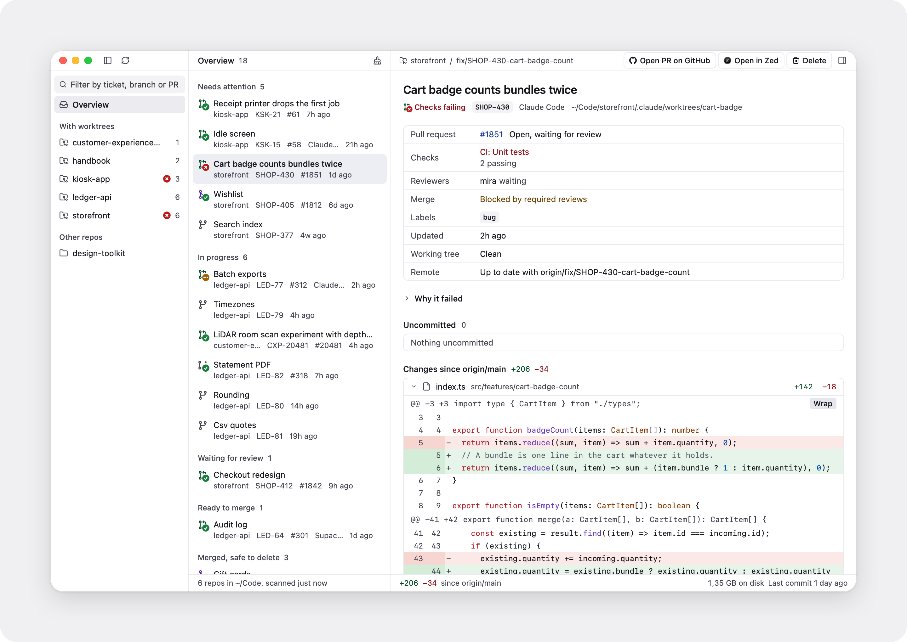
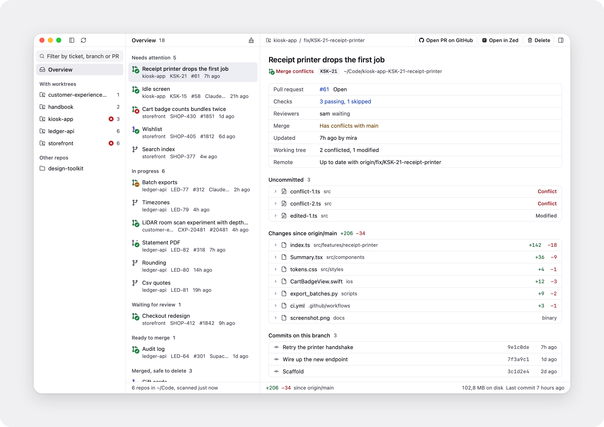

<picture>
  <source media="(prefers-color-scheme: dark)" srcset="docs/hero-dark.png">
  
</picture>

A small Mac app that shows every git worktree on your Mac, with its pull request, checks and changes, so you can see what's done and clear it away.

Made for running many worktrees at once, one per ticket or per coding agent.

## Features

- Every worktree in one list, even ones outside your project folders
- Pull request, checks and reviews for each one
- Overview sorted into needs attention, in progress, ready and done
- Tags for the tool that made it: Claude Code, Codex, Cursor and more
- Changed files with diffs, commits and size on disk
- Tidy up: delete merged, closed and stale worktrees in one go, branches kept
- Opens in your editor or on GitHub
- Notifications when checks fail or a PR merges
- Menu bar icon, open at login, light and dark

<picture>
  <source media="(prefers-color-scheme: dark)" srcset="docs/tour-dark.png">
  
</picture>

## Install

```bash
brew install --cask antonijap/tap/worktrees
```

Or download the zip from the [latest release](https://github.com/antonijap/worktrees/releases/latest) and drag Worktrees.app to Applications. Needs macOS 14 or later.

For pull requests and checks, install the [GitHub CLI](https://cli.github.com) and run `gh auth login` once.

## Command line

`worktrees` shows the same view in a terminal, and `--json` gives it to scripts and agents. Homebrew installs it; otherwise use Worktrees, Install Command Line Tool.

```bash
worktrees                  # grouped like the Overview
worktrees list --attention # only what needs you
worktrees show feat/login  # one worktree
worktrees tidy             # what Tidy up would offer
worktrees list --json      # for scripts and agents
```

It only reads: nothing is ever changed or deleted from the command line.

## Shortcuts

| Shortcut | Action |
| --- | --- |
| ⌘R | Rescan |
| ⌘F | Filter |
| ⇧⌘T | Tidy up |
| ⇧⌘G | Open on GitHub |
| ⌘O | Open in your editor |
| ⌘⌫ | Delete worktree |

## Privacy

Worktrees only reads your folders. The only network requests go to GitHub through your own `gh`: pull requests, checks, and a daily check for a new version (turn that off in Settings). More in [how it works](docs/how-it-works.md).

## Contributing

See [CONTRIBUTING.md](CONTRIBUTING.md).

## Credits

- Line icons from [Lucide](https://lucide.dev) (ISC).
- Pull request icons and the GitHub mark from [Octicons](https://primer.style/octicons) (MIT).
- The layout borrows from Zed's Delta, and the worktree icons follow [Supacode](https://supacode.sh).

## License

[MIT](LICENSE)
